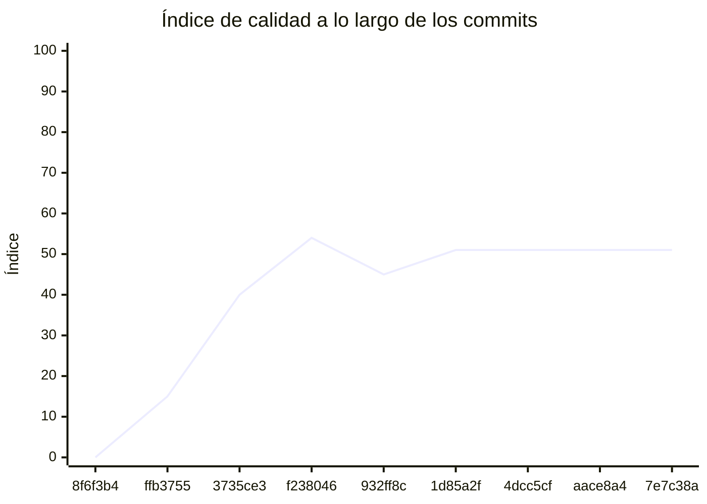

<!-- evaluacion:inicio -->
# Evaluación — TONEATTI-PROGRAMACION-TRABAJO-FINAL/Servicio-turnos

> Documento **generado automáticamente** por la cátedra de Programación II (UM): RepoSense + análisis de calidad de **7 dimensiones**. **No editar a mano**: se regenera en cada evaluación.
> Rama evaluada: `main`. Análisis **heurístico** (regex + métricas) + build: es una criba para orientar la revisión, **no una nota**. La **documentación** del repositorio no se evalúa.
> Generado: 2026-11-12.

## 1. Veredicto

| Aspecto | Resultado |
|---|---|
| Índice de calidad | **62/100** |
| Tipo de repositorio | `backend` |
| Build (`mvnw verify` / `gradlew check`) | OK |
| Código (LOC) | 11,469 |
| Archivos de código | 235 |
| Clases | 248 |
| Código dentro de clases (%POO) | 75% |
| Funciones fuera de clases | 0 |
| Duplicación (puerta) | 1.4% |
| Duplicación lógica | 1.5% |
| Duplicación de boilerplate | 9.5% |
| Cobertura | 99% |
| Tope duro aplicado a D1 | `POO_BAJO` → D1 ≤ 60 |

> Este informe **describe** lo que el análisis midió con los criterios ya establecidos de la materia. No es una nota.

## 2. Semáforo de aprobación

Criterios de la cátedra (`CRITERIOS-CALIDAD.md`): **Aprobar** se juega con el perfil `estandar`; **destacar**, con el `exigente` (meta de excelencia).

| Semáforo | Resultado |
|---|---|
| Aprobar (`estandar`) | **no cumple** — 5/11 |
| Destacar (`exigente`) | **no cumple** — 3/11 |

**Para aprobar, falta cumplir:** SOLID; SEC; SQL

**Para destacar, falta cumplir:** SOLID; POO; Duplicación; SEC; SQL

## 3. Autoría (RepoSense)

| Autor | Commits | Código (LOC) | Tests (LOC) | Docs (LOC) | Días activos | % del código |
|---|---:|---:|---:|---:|---:|---:|
| LucianoToneatti | 75 | 5,165 | 8,414 | 297 | 19 | 100% |

> _El LOC de autoría lo calcula RepoSense sobre el historial y puede diferir del LOC de código del análisis (que mira el estado de `main`)._

## 4. Dimensiones evaluadas

Cada dimensión indica **qué mide**, **por qué importa** y **tu resultado**. Cuando el puntaje queda por debajo de la referencia, se agregan preguntas para **investigar la causa** (no hay recetas).

| Dimensión | Peso | Puntaje |
|:--|--:|--:|
| **D1** Diseño OO, SOLID y patrones (20%) | 20% | 1 |
| **D2** Arquitectura hexagonal — backend (15%) | 15% | 100 |
| **D3** Frontend KMP: MVVM y buenas prácticas (10%) | 10% | N/A |
| **D4** Integración y contrato (10%) | 10% | 90 |
| **D5** Seguridad y robustez (10%) | 10% | 0 |
| **D6** Pruebas y cobertura (20%) | 20% | 100 |
| **D7** Proceso y entrega (15%) | 15% | 77 |

### D1. Diseño OO, SOLID y patrones (20%)

- **Qué mide:** Métricas orientadas a objetos (clases, métodos, campos, cohesión, acoplamiento, herencia) y proxies de SOLID, más patrones de diseño.
- **Por qué importa:** El eje de la materia es el buen uso de la POO y su arquitectura: un diseño con clases claras y poco acopladas es más fácil de entender, probar y cambiar.
- **Tu resultado:** **1/100**
- **Para investigar la causa:**
    - ¿Se pensó el modelo de clases antes de codificar o se agrupó después?
    - ¿Qué clases concentran muchas responsabilidades a la vez?
    - ¿Los colaboradores llegan como parámetros o se crean por dentro?

### D2. Arquitectura hexagonal — backend (15%)

- **Qué mide:** Separación en capas (dominio, puertos de entrada/salida, adaptadores) y dirección de las dependencias del backend.
- **Por qué importa:** Aislar el dominio de la infraestructura permite cambiar la base de datos, el framework o el transporte sin tocar las reglas de negocio.
- **Tu resultado:** **100/100**

### D4. Integración y contrato (10%)

- **Qué mide:** Cumplimiento del contrato de integración de la cátedra (formato de errores, paginación, autenticación, endpoints esperados).
- **Por qué importa:** Los servicios deben poder integrarse entre sí y con la app sin sorpresas; el contrato es lo que hacen cumplir las pruebas de integración.
- **Tu resultado:** **90/100**

### D5. Seguridad y robustez (10%)

- **Qué mide:** Credenciales embebidas, consultas SQL por concatenación, y presencia de config de entorno; aislamiento de secretos.
- **Por qué importa:** Un secreto en el repositorio o una consulta construida por concatenación son riesgos concretos, no hipotéticos.
- **Tu resultado:** **0/100**
- **Para investigar la causa:**
    - ¿De dónde salen las credenciales que usa el sistema?
    - ¿Qué consultas se arman con texto en vez de parámetros?
    - ¿Qué pasa si falta una variable de entorno al arrancar?

### D6. Pruebas y cobertura (20%)

- **Qué mide:** Cantidad y resultado de pruebas y cobertura de línea (JaCoCo/Kover, Surefire/Failsafe) cuando hay build.
- **Por qué importa:** Las pruebas son la red de seguridad para refactorizar e integrar; la cobertura acota las zonas sin verificar.
- **Tu resultado:** **100/100**

### D7. Proceso y entrega (15%)

- **Qué mide:** Artefactos verificables de proceso/entrega: `compose`, `.env.example`, CI (`.github/workflows/`), `CODEOWNERS` y wrapper de build (`mvnw`/`gradlew`). **No** puntúa documentación.
- **Por qué importa:** Un proyecto que compila, se levanta y se valida solo es más fácil de revisar y de integrar en equipo.
- **Tu resultado:** **77/100**

## 5. Señales detectadas

El análisis encontró las siguientes señales (archivo, sin número de línea a propósito):

**SRP/responsabilidad** (78)
- clase 'CatedraRestMapper' grande (LOC=74, métodos=11, campos=0) — `src/main/java/com/toneatti/turnos/catedra/infrastructure/rest/mapper/CatedraRestMapper.java`
- clase 'RestCatedraRepositoryAdapter' grande (LOC=169, métodos=16, campos=9) — `src/main/java/com/toneatti/turnos/catedra/infrastructure/rest/adapter/RestCatedraRepositoryAdapter.java`
- clase 'RestCatedraRepositoryAdapter' con baja cohesión (9%) — `src/main/java/com/toneatti/turnos/catedra/infrastructure/rest/adapter/RestCatedraRepositoryAdapter.java`
- clase 'CatedraRequestRejectedException' grande (LOC=28, métodos=3, campos=15) — `src/main/java/com/toneatti/turnos/catedra/domain/exception/CatedraRequestRejectedException.java`
- método 'AppointmentActionMessageMapper.toDomain' con complejidad 9 — `src/main/java/com/toneatti/turnos/reservation/infrastructure/kafka/mapper/AppointmentActionMessageMapper.java`
- clase 'ProcessedAppointmentActionEntity' sin métodos (6 campos): solo datos — `src/main/java/com/toneatti/turnos/reservation/infrastructure/persistence/entity/ProcessedAppointmentActionEntity.java`
- clase 'ReservationProcessEntity' grande (LOC=41, métodos=0, campos=18) — `src/main/java/com/toneatti/turnos/reservation/infrastructure/persistence/entity/ReservationProcessEntity.java`
- clase 'ReservationProcessEntity' sin métodos (18 campos): solo datos — `src/main/java/com/toneatti/turnos/reservation/infrastructure/persistence/entity/ReservationProcessEntity.java`
- clase 'ReservationController' con baja cohesión (0%) — `src/main/java/com/toneatti/turnos/reservation/infrastructure/web/controller/ReservationController.java`
- clase 'ReservationResponse' grande (LOC=12, métodos=0, campos=10) — `src/main/java/com/toneatti/turnos/reservation/infrastructure/web/dto/ReservationResponse.java`
- clase 'ReservationResponse' sin métodos (10 campos): solo datos — `src/main/java/com/toneatti/turnos/reservation/infrastructure/web/dto/ReservationResponse.java`
- clase 'ReservationRequest' sin métodos (3 campos): solo datos — `src/main/java/com/toneatti/turnos/reservation/infrastructure/web/dto/ReservationRequest.java`
- clase 'ReservationPageResponse' sin métodos (4 campos): solo datos — `src/main/java/com/toneatti/turnos/reservation/infrastructure/web/dto/ReservationPageResponse.java`
- clase 'ReservationSummaryResponse' grande (LOC=14, métodos=0, campos=12) — `src/main/java/com/toneatti/turnos/reservation/infrastructure/web/dto/ReservationSummaryResponse.java`
- clase 'ReservationSummaryResponse' sin métodos (12 campos): solo datos — `src/main/java/com/toneatti/turnos/reservation/infrastructure/web/dto/ReservationSummaryResponse.java`
- clase 'ReservationService' con baja cohesión (19%) — `src/main/java/com/toneatti/turnos/reservation/application/service/ReservationService.java`
- clase 'ApplyAppointmentActionUseCaseImpl' con baja cohesión (10%) — `src/main/java/com/toneatti/turnos/reservation/application/usecases/ApplyAppointmentActionUseCaseImpl.java`
- clase 'CancelReservationUseCaseImpl' con baja cohesión (20%) — `src/main/java/com/toneatti/turnos/reservation/application/usecases/CancelReservationUseCaseImpl.java`
- método 'CancelReservationUseCaseImpl.findByReservationProcessIdAndUserExternalId' con complejidad 7 — `src/main/java/com/toneatti/turnos/reservation/application/usecases/CancelReservationUseCaseImpl.java`
- método 'CancelReservationUseCaseImpl.cancel' con complejidad 7 — `src/main/java/com/toneatti/turnos/reservation/application/usecases/CancelReservationUseCaseImpl.java`
- clase 'StartReservationUseCaseImpl' grande (LOC=197, métodos=13, campos=7) — `src/main/java/com/toneatti/turnos/reservation/application/usecases/StartReservationUseCaseImpl.java`
- clase 'StartReservationUseCaseImpl' con baja cohesión (47%) — `src/main/java/com/toneatti/turnos/reservation/application/usecases/StartReservationUseCaseImpl.java`
- método 'StartReservationUseCaseImpl.resume' con complejidad 6 — `src/main/java/com/toneatti/turnos/reservation/application/usecases/StartReservationUseCaseImpl.java`
- método 'StartReservationUseCaseImpl.filter' con complejidad 6 — `src/main/java/com/toneatti/turnos/reservation/application/usecases/StartReservationUseCaseImpl.java`
- método 'StartReservationUseCaseImpl.startTime' con complejidad 6 — `src/main/java/com/toneatti/turnos/reservation/application/usecases/StartReservationUseCaseImpl.java`
- método 'StartReservationUseCaseImpl.confirm' de 36 líneas — `src/main/java/com/toneatti/turnos/reservation/application/usecases/StartReservationUseCaseImpl.java`
- método 'StartReservationUseCaseImpl.confirm' con complejidad 9 — `src/main/java/com/toneatti/turnos/reservation/application/usecases/StartReservationUseCaseImpl.java`
- clase 'ReservationProcess' grande (LOC=219, métodos=34, campos=17) — `src/main/java/com/toneatti/turnos/reservation/domain/model/ReservationProcess.java`
- clase 'ReservationProcess' con baja cohesión (11%) — `src/main/java/com/toneatti/turnos/reservation/domain/model/ReservationProcess.java`
- método 'ReservationProcess.apply' con complejidad 7 — `src/main/java/com/toneatti/turnos/reservation/domain/model/ReservationProcess.java`
- método 'ReservationStatus.nextStatuses' con complejidad 7 — `src/main/java/com/toneatti/turnos/reservation/domain/model/ReservationStatus.java`
- clase 'AvailableSlotResponse' sin métodos (3 campos): solo datos — `src/main/java/com/toneatti/turnos/availability/infrastructure/web/dto/AvailableSlotResponse.java`
- clase 'GetAvailableSlotsUseCaseImpl' con baja cohesión (0%) — `src/main/java/com/toneatti/turnos/availability/application/usecases/GetAvailableSlotsUseCaseImpl.java`
- método 'GetAvailableSlotsUseCaseImpl.generateSlots' con complejidad 6 — `src/main/java/com/toneatti/turnos/availability/application/usecases/GetAvailableSlotsUseCaseImpl.java`
- clase 'SecurityConfig' con baja cohesión (0%) — `src/main/java/com/toneatti/turnos/config/SecurityConfig.java`
- clase 'UserEntity' sin métodos (7 campos): solo datos — `src/main/java/com/toneatti/turnos/user/infrastructure/persistence/entity/UserEntity.java`
- clase 'UserRequest' sin métodos (4 campos): solo datos — `src/main/java/com/toneatti/turnos/user/infrastructure/web/dto/UserRequest.java`
- clase 'UserResponse' sin métodos (4 campos): solo datos — `src/main/java/com/toneatti/turnos/user/infrastructure/web/dto/UserResponse.java`
- clase 'TokenResponse' sin métodos (3 campos): solo datos — `src/main/java/com/toneatti/turnos/user/infrastructure/web/dto/TokenResponse.java`
- clase 'UserService' con baja cohesión (33%) — `src/main/java/com/toneatti/turnos/user/application/service/UserService.java`
- clase 'ProfessionalCategoryResponse' sin métodos (3 campos): solo datos — `src/main/java/com/toneatti/turnos/catalogo/infrastructure/web/dto/ProfessionalCategoryResponse.java`
- clase 'ProfessionalResponse' sin métodos (5 campos): solo datos — `src/main/java/com/toneatti/turnos/catalogo/infrastructure/web/dto/ProfessionalResponse.java`
- clase 'RestCatedraRepositoryAdapterTest' grande (LOC=470, métodos=65, campos=15) — `src/test/java/com/toneatti/turnos/catedra/infrastructure/rest/adapter/RestCatedraRepositoryAdapterTest.java`
- clase 'FakeHttpServer' grande (LOC=132, métodos=19, campos=9) — `src/test/java/com/toneatti/turnos/support/FakeHttpServer.java`
- clase 'FakeHttpServer' con baja cohesión (16%) — `src/test/java/com/toneatti/turnos/support/FakeHttpServer.java`
- método 'FakeHttpServer.CannedResponse' con 5 parámetros — `src/test/java/com/toneatti/turnos/support/FakeHttpServer.java`
- método 'FakeHttpServer.respond' con 5 parámetros — `src/test/java/com/toneatti/turnos/support/FakeHttpServer.java`
- método 'FakeHttpServer.handle' con complejidad 6 — `src/test/java/com/toneatti/turnos/support/FakeHttpServer.java`
- método 'CannedResponse.CannedResponse' con 5 parámetros — `src/test/java/com/toneatti/turnos/support/FakeHttpServer.java`
- método 'AppointmentActionMessages.json' con complejidad 8 — `src/test/java/com/toneatti/turnos/reservation/infrastructure/kafka/AppointmentActionMessages.java`
- clase 'AppointmentActionListenerIntegrationTest' grande (LOC=148, métodos=17, campos=9) — `src/test/java/com/toneatti/turnos/reservation/infrastructure/kafka/listener/AppointmentActionListenerIntegrationTest.java`
- clase 'AppointmentActionListenerIntegrationTest' con baja cohesión (11%) — `src/test/java/com/toneatti/turnos/reservation/infrastructure/kafka/listener/AppointmentActionListenerIntegrationTest.java`
- clase 'JpaReservationProcessRepositoryAdapterIntegrationTest' grande (LOC=119, métodos=16, campos=6) — `src/test/java/com/toneatti/turnos/reservation/infrastructure/persistence/adapter/JpaReservationProcessRepositoryAdapterIntegrationTest.java`
- clase 'ReservationIntegrationTest' grande (LOC=455, métodos=50, campos=16) — `src/test/java/com/toneatti/turnos/reservation/infrastructure/web/controller/ReservationIntegrationTest.java`
- clase 'PhoneSubmissionIntegrationTest' grande (LOC=155, métodos=23, campos=10) — `src/test/java/com/toneatti/turnos/reservation/infrastructure/web/controller/PhoneSubmissionIntegrationTest.java`
- clase 'PhoneSubmissionIntegrationTest' con baja cohesión (44%) — `src/test/java/com/toneatti/turnos/reservation/infrastructure/web/controller/PhoneSubmissionIntegrationTest.java`
- clase 'CancellationIntegrationTest' grande (LOC=172, métodos=26, campos=10) — `src/test/java/com/toneatti/turnos/reservation/infrastructure/web/controller/CancellationIntegrationTest.java`
- clase 'CancellationIntegrationTest' con baja cohesión (49%) — `src/test/java/com/toneatti/turnos/reservation/infrastructure/web/controller/CancellationIntegrationTest.java`
- clase 'ReservationServiceTest' grande (LOC=88, métodos=10, campos=9) — `src/test/java/com/toneatti/turnos/reservation/application/service/ReservationServiceTest.java`
- clase 'CancelReservationUseCaseImplTest' grande (LOC=176, métodos=23, campos=9) — `src/test/java/com/toneatti/turnos/reservation/application/usecases/CancelReservationUseCaseImplTest.java`
- clase 'ApplyAppointmentActionUseCaseImplTest' grande (LOC=104, métodos=13, campos=5) — `src/test/java/com/toneatti/turnos/reservation/application/usecases/ApplyAppointmentActionUseCaseImplTest.java`
- clase 'SubmitPhoneUseCaseImplTest' grande (LOC=146, métodos=21, campos=7) — `src/test/java/com/toneatti/turnos/reservation/application/usecases/SubmitPhoneUseCaseImplTest.java`
- clase 'StartReservationUseCaseImplTest' grande (LOC=382, métodos=48, campos=16) — `src/test/java/com/toneatti/turnos/reservation/application/usecases/StartReservationUseCaseImplTest.java`
- clase 'AppointmentActionFixtures' grande (LOC=19, métodos=1, campos=8) — `src/test/java/com/toneatti/turnos/reservation/domain/model/AppointmentActionFixtures.java`
- clase 'ReservationProcessTest' grande (LOC=216, métodos=27, campos=3) — `src/test/java/com/toneatti/turnos/reservation/domain/model/ReservationProcessTest.java`
- clase 'ReservationProcessTest' con baja cohesión (44%) — `src/test/java/com/toneatti/turnos/reservation/domain/model/ReservationProcessTest.java`
- método 'ReservationProcessTest.ReservationProcess' con 5 parámetros — `src/test/java/com/toneatti/turnos/reservation/domain/model/ReservationProcessTest.java`
- clase 'AvailabilityIntegrationTest' grande (LOC=118, métodos=18, campos=7) — `src/test/java/com/toneatti/turnos/availability/infrastructure/web/controller/AvailabilityIntegrationTest.java`
- clase 'AvailabilityIntegrationTest' con baja cohesión (24%) — `src/test/java/com/toneatti/turnos/availability/infrastructure/web/controller/AvailabilityIntegrationTest.java`
- clase 'GetAvailableSlotsUseCaseImplTest' grande (LOC=188, métodos=26, campos=7) — `src/test/java/com/toneatti/turnos/availability/application/usecases/GetAvailableSlotsUseCaseImplTest.java`
- clase 'CatalogoServicePropertiesTest' grande (LOC=53, métodos=10, campos=1) — `src/test/java/com/toneatti/turnos/config/CatalogoServicePropertiesTest.java`
- clase 'CatedraIntegrationPropertiesTest' grande (LOC=137, métodos=20, campos=1) — `src/test/java/com/toneatti/turnos/config/CatedraIntegrationPropertiesTest.java`
- clase 'UserLoginIntegrationTest' grande (LOC=79, métodos=14, campos=4) — `src/test/java/com/toneatti/turnos/user/infrastructure/web/controller/UserLoginIntegrationTest.java`
- clase 'UserLoginIntegrationTest' con baja cohesión (40%) — `src/test/java/com/toneatti/turnos/user/infrastructure/web/controller/UserLoginIntegrationTest.java`
- clase 'CurrentUserIntegrationTest' grande (LOC=86, métodos=15, campos=3) — `src/test/java/com/toneatti/turnos/user/infrastructure/web/controller/CurrentUserIntegrationTest.java`
- clase 'CurrentUserIntegrationTest' con baja cohesión (43%) — `src/test/java/com/toneatti/turnos/user/infrastructure/web/controller/CurrentUserIntegrationTest.java`
- clase 'RestCatalogoRepositoryAdapterTest' grande (LOC=166, métodos=23, campos=6) — `src/test/java/com/toneatti/turnos/catalogo/infrastructure/rest/adapter/RestCatalogoRepositoryAdapterTest.java`
- clase 'CatalogoIntegrationTest' grande (LOC=120, métodos=13, campos=5) — `src/test/java/com/toneatti/turnos/catalogo/infrastructure/web/controller/CatalogoIntegrationTest.java`

**DIP/concretos** (129)
- clase 'CatedraRestMapper' muy acoplada (CBO=12) — `src/main/java/com/toneatti/turnos/catedra/infrastructure/rest/mapper/CatedraRestMapper.java`
- clase 'CatedraRestMapper' instancia 6 concretos (CBO=12) — `src/main/java/com/toneatti/turnos/catedra/infrastructure/rest/mapper/CatedraRestMapper.java`
- clase 'RestCatedraRepositoryAdapter' muy acoplada (CBO=53) — `src/main/java/com/toneatti/turnos/catedra/infrastructure/rest/adapter/RestCatedraRepositoryAdapter.java`
- clase 'RestCatedraRepositoryAdapter' instancia 8 concretos (CBO=53) — `src/main/java/com/toneatti/turnos/catedra/infrastructure/rest/adapter/RestCatedraRepositoryAdapter.java`
- clase 'CatedraRepository' muy acoplada (CBO=20) — `src/main/java/com/toneatti/turnos/catedra/domain/ports/out/CatedraRepository.java`
- clase 'AppointmentActionListener' muy acoplada (CBO=11) — `src/main/java/com/toneatti/turnos/reservation/infrastructure/kafka/listener/AppointmentActionListener.java`
- clase 'AppointmentActionMessageMapper' muy acoplada (CBO=12) — `src/main/java/com/toneatti/turnos/reservation/infrastructure/kafka/mapper/AppointmentActionMessageMapper.java`
- clase 'AppointmentActionMessageMapper' instancia 9 concretos (CBO=12) — `src/main/java/com/toneatti/turnos/reservation/infrastructure/kafka/mapper/AppointmentActionMessageMapper.java`
- clase 'KafkaPhoneSubmissionPublisherAdapter' muy acoplada (CBO=14) — `src/main/java/com/toneatti/turnos/reservation/infrastructure/kafka/adapter/KafkaPhoneSubmissionPublisherAdapter.java`
- clase 'PhoneSubmissionKafkaConfig' muy acoplada (CBO=18) — `src/main/java/com/toneatti/turnos/reservation/infrastructure/kafka/config/PhoneSubmissionKafkaConfig.java`
- clase 'AppointmentActionsKafkaConfig' muy acoplada (CBO=23) — `src/main/java/com/toneatti/turnos/reservation/infrastructure/kafka/config/AppointmentActionsKafkaConfig.java`
- clase 'JpaReservationProcessRepositoryAdapter' muy acoplada (CBO=16) — `src/main/java/com/toneatti/turnos/reservation/infrastructure/persistence/adapter/JpaReservationProcessRepositoryAdapter.java`
- clase 'ReservationProcessEntity' muy acoplada (CBO=16) — `src/main/java/com/toneatti/turnos/reservation/infrastructure/persistence/entity/ReservationProcessEntity.java`
- clase 'ReservationController' muy acoplada (CBO=83) — `src/main/java/com/toneatti/turnos/reservation/infrastructure/web/controller/ReservationController.java`
- clase 'ReservationDtoMapper' muy acoplada (CBO=13) — `src/main/java/com/toneatti/turnos/reservation/infrastructure/web/mapper/ReservationDtoMapper.java`
- clase 'ReservationService' muy acoplada (CBO=16) — `src/main/java/com/toneatti/turnos/reservation/application/service/ReservationService.java`
- clase 'ReservationService' instancia 3 concretos (CBO=16) — `src/main/java/com/toneatti/turnos/reservation/application/service/ReservationService.java`
- clase 'ApplyAppointmentActionUseCaseImpl' muy acoplada (CBO=17) — `src/main/java/com/toneatti/turnos/reservation/application/usecases/ApplyAppointmentActionUseCaseImpl.java`
- clase 'ListReservationsUseCaseImpl' muy acoplada (CBO=15) — `src/main/java/com/toneatti/turnos/reservation/application/usecases/ListReservationsUseCaseImpl.java`
- clase 'ListReservationsUseCaseImpl' instancia 4 concretos (CBO=15) — `src/main/java/com/toneatti/turnos/reservation/application/usecases/ListReservationsUseCaseImpl.java`
- clase 'CancelReservationUseCaseImpl' muy acoplada (CBO=30) — `src/main/java/com/toneatti/turnos/reservation/application/usecases/CancelReservationUseCaseImpl.java`
- clase 'CancelReservationUseCaseImpl' instancia 8 concretos (CBO=30) — `src/main/java/com/toneatti/turnos/reservation/application/usecases/CancelReservationUseCaseImpl.java`
- clase 'StartReservationUseCaseImpl' muy acoplada (CBO=61) — `src/main/java/com/toneatti/turnos/reservation/application/usecases/StartReservationUseCaseImpl.java`
- clase 'StartReservationUseCaseImpl' instancia 15 concretos (CBO=61) — `src/main/java/com/toneatti/turnos/reservation/application/usecases/StartReservationUseCaseImpl.java`
- clase 'GetReservationByIdUseCaseImpl' muy acoplada (CBO=11) — `src/main/java/com/toneatti/turnos/reservation/application/usecases/GetReservationByIdUseCaseImpl.java`
- clase 'SubmitPhoneUseCaseImpl' muy acoplada (CBO=15) — `src/main/java/com/toneatti/turnos/reservation/application/usecases/SubmitPhoneUseCaseImpl.java`
- clase 'SubmitPhoneUseCaseImpl' instancia 4 concretos (CBO=15) — `src/main/java/com/toneatti/turnos/reservation/application/usecases/SubmitPhoneUseCaseImpl.java`
- clase 'ReservationProcess' muy acoplada (CBO=24) — `src/main/java/com/toneatti/turnos/reservation/domain/model/ReservationProcess.java`
- clase 'ReservationProcess' instancia 3 concretos (CBO=24) — `src/main/java/com/toneatti/turnos/reservation/domain/model/ReservationProcess.java`
- clase 'ReservationStatus' muy acoplada (CBO=9) — `src/main/java/com/toneatti/turnos/reservation/domain/model/ReservationStatus.java`
- clase 'AvailabilityController' muy acoplada (CBO=30) — `src/main/java/com/toneatti/turnos/availability/infrastructure/web/controller/AvailabilityController.java`
- clase 'GetAvailableSlotsUseCaseImpl' muy acoplada (CBO=29) — `src/main/java/com/toneatti/turnos/availability/application/usecases/GetAvailableSlotsUseCaseImpl.java`
- clase 'GetAvailableSlotsUseCaseImpl' instancia 7 concretos (CBO=29) — `src/main/java/com/toneatti/turnos/availability/application/usecases/GetAvailableSlotsUseCaseImpl.java`
- clase 'CatedraIntegrationProperties' muy acoplada (CBO=8) — `src/main/java/com/toneatti/turnos/config/CatedraIntegrationProperties.java`
- clase 'SecurityConfig' muy acoplada (CBO=40) — `src/main/java/com/toneatti/turnos/config/SecurityConfig.java`
- clase 'JwtAccessTokenIssuerAdapter' muy acoplada (CBO=14) — `src/main/java/com/toneatti/turnos/user/infrastructure/security/JwtAccessTokenIssuerAdapter.java`
- clase 'JpaUserRepositoryAdapter' muy acoplada (CBO=8) — `src/main/java/com/toneatti/turnos/user/infrastructure/persistence/adapter/JpaUserRepositoryAdapter.java`
- clase 'UserController' muy acoplada (CBO=25) — `src/main/java/com/toneatti/turnos/user/infrastructure/web/controller/UserController.java`
- clase 'UserController' instancia 3 concretos (CBO=25) — `src/main/java/com/toneatti/turnos/user/infrastructure/web/controller/UserController.java`
- clase 'UserDtoMapper' muy acoplada (CBO=8) — `src/main/java/com/toneatti/turnos/user/infrastructure/web/mapper/UserDtoMapper.java`
- clase 'UserService' muy acoplada (CBO=8) — `src/main/java/com/toneatti/turnos/user/application/service/UserService.java`
- clase 'RegisterUserUseCaseImpl' muy acoplada (CBO=8) — `src/main/java/com/toneatti/turnos/user/application/usecases/RegisterUserUseCaseImpl.java`
- clase 'LoginUserUseCaseImpl' muy acoplada (CBO=8) — `src/main/java/com/toneatti/turnos/user/application/usecases/LoginUserUseCaseImpl.java`
- clase 'RestCatalogoRepositoryAdapter' muy acoplada (CBO=19) — `src/main/java/com/toneatti/turnos/catalogo/infrastructure/rest/adapter/RestCatalogoRepositoryAdapter.java`
- clase 'ProfessionalCategoryController' muy acoplada (CBO=13) — `src/main/java/com/toneatti/turnos/catalogo/infrastructure/web/controller/ProfessionalCategoryController.java`
- clase 'ProfessionalController' muy acoplada (CBO=17) — `src/main/java/com/toneatti/turnos/catalogo/infrastructure/web/controller/ProfessionalController.java`
- clase 'CatedraRestMapperTest' muy acoplada (CBO=26) — `src/test/java/com/toneatti/turnos/catedra/infrastructure/rest/mapper/CatedraRestMapperTest.java`
- clase 'CatedraRestMapperTest' instancia 10 concretos (CBO=26) — `src/test/java/com/toneatti/turnos/catedra/infrastructure/rest/mapper/CatedraRestMapperTest.java`
- clase 'RestCatedraRepositoryAdapterTest' muy acoplada (CBO=70) — `src/test/java/com/toneatti/turnos/catedra/infrastructure/rest/adapter/RestCatedraRepositoryAdapterTest.java`
- clase 'RestCatedraRepositoryAdapterTest' instancia 13 concretos (CBO=70) — `src/test/java/com/toneatti/turnos/catedra/infrastructure/rest/adapter/RestCatedraRepositoryAdapterTest.java`
- clase 'FakeHttpServerTest' muy acoplada (CBO=11) — `src/test/java/com/toneatti/turnos/support/FakeHttpServerTest.java`
- clase 'ConfigurationPropertiesAssertions' muy acoplada (CBO=12) — `src/test/java/com/toneatti/turnos/support/ConfigurationPropertiesAssertions.java`
- clase 'FakeHttpServer' muy acoplada (CBO=39) — `src/test/java/com/toneatti/turnos/support/FakeHttpServer.java`
- clase 'FakeHttpServer' instancia 10 concretos (CBO=39) — `src/test/java/com/toneatti/turnos/support/FakeHttpServer.java`
- clase 'PhoneTopicRecords' muy acoplada (CBO=11) — `src/test/java/com/toneatti/turnos/reservation/infrastructure/kafka/PhoneTopicRecords.java`
- clase 'AppointmentActionMessages' muy acoplada (CBO=12) — `src/test/java/com/toneatti/turnos/reservation/infrastructure/kafka/AppointmentActionMessages.java`
- clase 'AppointmentActionListenerIntegrationTest' muy acoplada (CBO=39) — `src/test/java/com/toneatti/turnos/reservation/infrastructure/kafka/listener/AppointmentActionListenerIntegrationTest.java`
- clase 'AppointmentActionListenerIntegrationTest' instancia 11 concretos (CBO=39) — `src/test/java/com/toneatti/turnos/reservation/infrastructure/kafka/listener/AppointmentActionListenerIntegrationTest.java`
- clase 'AppointmentActionListenerTest' muy acoplada (CBO=13) — `src/test/java/com/toneatti/turnos/reservation/infrastructure/kafka/listener/AppointmentActionListenerTest.java`
- clase 'AppointmentActionListenerTest' instancia 3 concretos (CBO=13) — `src/test/java/com/toneatti/turnos/reservation/infrastructure/kafka/listener/AppointmentActionListenerTest.java`
- clase 'AppointmentActionMessageMapperTest' muy acoplada (CBO=16) — `src/test/java/com/toneatti/turnos/reservation/infrastructure/kafka/mapper/AppointmentActionMessageMapperTest.java`
- clase 'AppointmentActionMessageMapperTest' instancia 9 concretos (CBO=16) — `src/test/java/com/toneatti/turnos/reservation/infrastructure/kafka/mapper/AppointmentActionMessageMapperTest.java`
- clase 'KafkaPhoneSubmissionPublisherAdapterIntegrationTest' muy acoplada (CBO=12) — `src/test/java/com/toneatti/turnos/reservation/infrastructure/kafka/adapter/KafkaPhoneSubmissionPublisherAdapterIntegrationTest.java`
- clase 'KafkaPhoneSubmissionPublisherAdapterIntegrationTest' instancia 3 concretos (CBO=12) — `src/test/java/com/toneatti/turnos/reservation/infrastructure/kafka/adapter/KafkaPhoneSubmissionPublisherAdapterIntegrationTest.java`
- clase 'KafkaPhoneSubmissionPublisherAdapterTest' muy acoplada (CBO=19) — `src/test/java/com/toneatti/turnos/reservation/infrastructure/kafka/adapter/KafkaPhoneSubmissionPublisherAdapterTest.java`
- clase 'KafkaPhoneSubmissionPublisherAdapterTest' instancia 5 concretos (CBO=19) — `src/test/java/com/toneatti/turnos/reservation/infrastructure/kafka/adapter/KafkaPhoneSubmissionPublisherAdapterTest.java`
- clase 'AppointmentActionsKafkaConfigTest' muy acoplada (CBO=19) — `src/test/java/com/toneatti/turnos/reservation/infrastructure/kafka/config/AppointmentActionsKafkaConfigTest.java`
- clase 'PhoneSubmissionKafkaConfigTest' muy acoplada (CBO=22) — `src/test/java/com/toneatti/turnos/reservation/infrastructure/kafka/config/PhoneSubmissionKafkaConfigTest.java`
- clase 'ReservationProcessMapperTest' muy acoplada (CBO=19) — `src/test/java/com/toneatti/turnos/reservation/infrastructure/persistence/mapper/ReservationProcessMapperTest.java`
- clase 'JpaReservationProcessRepositoryAdapterIntegrationTest' muy acoplada (CBO=14) — `src/test/java/com/toneatti/turnos/reservation/infrastructure/persistence/adapter/JpaReservationProcessRepositoryAdapterIntegrationTest.java`
- clase 'JpaReservationProcessRepositoryAdapterTest' muy acoplada (CBO=11) — `src/test/java/com/toneatti/turnos/reservation/infrastructure/persistence/adapter/JpaReservationProcessRepositoryAdapterTest.java`
- clase 'JpaProcessedAppointmentActionRepositoryAdapterIntegrationTest' muy acoplada (CBO=9) — `src/test/java/com/toneatti/turnos/reservation/infrastructure/persistence/adapter/JpaProcessedAppointmentActionRepositoryAdapterIntegrationTest.java`
- clase 'ReservationIntegrationTest' muy acoplada (CBO=67) — `src/test/java/com/toneatti/turnos/reservation/infrastructure/web/controller/ReservationIntegrationTest.java`
- clase 'PhoneSubmissionIntegrationTest' muy acoplada (CBO=34) — `src/test/java/com/toneatti/turnos/reservation/infrastructure/web/controller/PhoneSubmissionIntegrationTest.java`
- clase 'CancellationIntegrationTest' muy acoplada (CBO=33) — `src/test/java/com/toneatti/turnos/reservation/infrastructure/web/controller/CancellationIntegrationTest.java`
- clase 'ReservationDtoMapperTest' muy acoplada (CBO=23) — `src/test/java/com/toneatti/turnos/reservation/infrastructure/web/mapper/ReservationDtoMapperTest.java`
- clase 'ReservationDtoMapperTest' instancia 7 concretos (CBO=23) — `src/test/java/com/toneatti/turnos/reservation/infrastructure/web/mapper/ReservationDtoMapperTest.java`
- clase 'ReservationServiceTest' muy acoplada (CBO=19) — `src/test/java/com/toneatti/turnos/reservation/application/service/ReservationServiceTest.java`
- clase 'CancelReservationUseCaseImplTest' muy acoplada (CBO=41) — `src/test/java/com/toneatti/turnos/reservation/application/usecases/CancelReservationUseCaseImplTest.java`
- clase 'CancelReservationUseCaseImplTest' instancia 8 concretos (CBO=41) — `src/test/java/com/toneatti/turnos/reservation/application/usecases/CancelReservationUseCaseImplTest.java`
- clase 'ApplyAppointmentActionUseCaseImplTest' muy acoplada (CBO=37) — `src/test/java/com/toneatti/turnos/reservation/application/usecases/ApplyAppointmentActionUseCaseImplTest.java`
- clase 'ApplyAppointmentActionUseCaseImplTest' instancia 4 concretos (CBO=37) — `src/test/java/com/toneatti/turnos/reservation/application/usecases/ApplyAppointmentActionUseCaseImplTest.java`
- clase 'GetReservationByIdUseCaseImplTest' muy acoplada (CBO=21) — `src/test/java/com/toneatti/turnos/reservation/application/usecases/GetReservationByIdUseCaseImplTest.java`
- clase 'GetReservationByIdUseCaseImplTest' instancia 3 concretos (CBO=21) — `src/test/java/com/toneatti/turnos/reservation/application/usecases/GetReservationByIdUseCaseImplTest.java`
- clase 'ListReservationsUseCaseImplTest' muy acoplada (CBO=12) — `src/test/java/com/toneatti/turnos/reservation/application/usecases/ListReservationsUseCaseImplTest.java`
- clase 'ListReservationsUseCaseImplTest' instancia 5 concretos (CBO=12) — `src/test/java/com/toneatti/turnos/reservation/application/usecases/ListReservationsUseCaseImplTest.java`
- clase 'SubmitPhoneUseCaseImplTest' muy acoplada (CBO=34) — `src/test/java/com/toneatti/turnos/reservation/application/usecases/SubmitPhoneUseCaseImplTest.java`
- clase 'SubmitPhoneUseCaseImplTest' instancia 6 concretos (CBO=34) — `src/test/java/com/toneatti/turnos/reservation/application/usecases/SubmitPhoneUseCaseImplTest.java`
- clase 'StartReservationUseCaseImplTest' muy acoplada (CBO=68) — `src/test/java/com/toneatti/turnos/reservation/application/usecases/StartReservationUseCaseImplTest.java`
- clase 'StartReservationUseCaseImplTest' instancia 20 concretos (CBO=68) — `src/test/java/com/toneatti/turnos/reservation/application/usecases/StartReservationUseCaseImplTest.java`
- clase 'InMemoryReservationProcessRepository' muy acoplada (CBO=17) — `src/test/java/com/toneatti/turnos/reservation/application/usecases/StartReservationUseCaseImplTest.java`
- clase 'InMemoryReservationProcessRepository' instancia 4 concretos (CBO=17) — `src/test/java/com/toneatti/turnos/reservation/application/usecases/StartReservationUseCaseImplTest.java`
- clase 'ApplyAppointmentActionUseCaseImplIntegrationTest' muy acoplada (CBO=25) — `src/test/java/com/toneatti/turnos/reservation/application/usecases/ApplyAppointmentActionUseCaseImplIntegrationTest.java`
- clase 'AppointmentActionFixtures' muy acoplada (CBO=12) — `src/test/java/com/toneatti/turnos/reservation/domain/model/AppointmentActionFixtures.java`
- clase 'AppointmentActionFixtures' instancia 6 concretos (CBO=12) — `src/test/java/com/toneatti/turnos/reservation/domain/model/AppointmentActionFixtures.java`
- clase 'ReservationProcessTest' muy acoplada (CBO=35) — `src/test/java/com/toneatti/turnos/reservation/domain/model/ReservationProcessTest.java`
- clase 'ReservationStatusTest' muy acoplada (CBO=12) — `src/test/java/com/toneatti/turnos/reservation/domain/model/ReservationStatusTest.java`
- clase 'AvailabilityIntegrationTest' muy acoplada (CBO=25) — `src/test/java/com/toneatti/turnos/availability/infrastructure/web/controller/AvailabilityIntegrationTest.java`
- clase 'GetAvailableSlotsUseCaseImplTest' muy acoplada (CBO=36) — `src/test/java/com/toneatti/turnos/availability/application/usecases/GetAvailableSlotsUseCaseImplTest.java`
- clase 'GetAvailableSlotsUseCaseImplTest' instancia 12 concretos (CBO=36) — `src/test/java/com/toneatti/turnos/availability/application/usecases/GetAvailableSlotsUseCaseImplTest.java`
- clase 'CatalogoServicePropertiesTest' muy acoplada (CBO=9) — `src/test/java/com/toneatti/turnos/config/CatalogoServicePropertiesTest.java`
- clase 'CatedraIntegrationPropertiesTest' muy acoplada (CBO=21) — `src/test/java/com/toneatti/turnos/config/CatedraIntegrationPropertiesTest.java`
- clase 'JwtAccessTokenIssuerAdapterTest' muy acoplada (CBO=17) — `src/test/java/com/toneatti/turnos/user/infrastructure/security/JwtAccessTokenIssuerAdapterTest.java`
- clase 'JwtAccessTokenIssuerAdapterTest' instancia 5 concretos (CBO=17) — `src/test/java/com/toneatti/turnos/user/infrastructure/security/JwtAccessTokenIssuerAdapterTest.java`
- clase 'JpaUserRepositoryAdapterTest' muy acoplada (CBO=10) — `src/test/java/com/toneatti/turnos/user/infrastructure/persistence/adapter/JpaUserRepositoryAdapterTest.java`
- clase 'JpaUserRepositoryAdapterTest' instancia 5 concretos (CBO=10) — `src/test/java/com/toneatti/turnos/user/infrastructure/persistence/adapter/JpaUserRepositoryAdapterTest.java`
- clase 'UserLoginIntegrationTest' muy acoplada (CBO=23) — `src/test/java/com/toneatti/turnos/user/infrastructure/web/controller/UserLoginIntegrationTest.java`
- clase 'ConcurrentUserRegistrationIntegrationTest' muy acoplada (CBO=9) — `src/test/java/com/toneatti/turnos/user/infrastructure/web/controller/ConcurrentUserRegistrationIntegrationTest.java`
- clase 'UserRegistrationIntegrationTest' muy acoplada (CBO=15) — `src/test/java/com/toneatti/turnos/user/infrastructure/web/controller/UserRegistrationIntegrationTest.java`
- clase 'CurrentUserIntegrationTest' muy acoplada (CBO=24) — `src/test/java/com/toneatti/turnos/user/infrastructure/web/controller/CurrentUserIntegrationTest.java`
- clase 'UserDtoMapperTest' muy acoplada (CBO=10) — `src/test/java/com/toneatti/turnos/user/infrastructure/web/mapper/UserDtoMapperTest.java`
- clase 'UserDtoMapperTest' instancia 3 concretos (CBO=10) — `src/test/java/com/toneatti/turnos/user/infrastructure/web/mapper/UserDtoMapperTest.java`
- clase 'UserServiceTest' muy acoplada (CBO=10) — `src/test/java/com/toneatti/turnos/user/application/service/UserServiceTest.java`
- clase 'UserServiceTest' instancia 4 concretos (CBO=10) — `src/test/java/com/toneatti/turnos/user/application/service/UserServiceTest.java`
- clase 'LoginUserUseCaseImplTest' muy acoplada (CBO=13) — `src/test/java/com/toneatti/turnos/user/application/usecases/LoginUserUseCaseImplTest.java`
- clase 'LoginUserUseCaseImplTest' instancia 3 concretos (CBO=13) — `src/test/java/com/toneatti/turnos/user/application/usecases/LoginUserUseCaseImplTest.java`
- clase 'RegisterUserUseCaseImplTest' muy acoplada (CBO=10) — `src/test/java/com/toneatti/turnos/user/application/usecases/RegisterUserUseCaseImplTest.java`
- clase 'UserTest' muy acoplada (CBO=9) — `src/test/java/com/toneatti/turnos/user/domain/model/UserTest.java`
- clase 'CatalogoRestMapperTest' muy acoplada (CBO=14) — `src/test/java/com/toneatti/turnos/catalogo/infrastructure/rest/mapper/CatalogoRestMapperTest.java`
- clase 'CatalogoRestMapperTest' instancia 4 concretos (CBO=14) — `src/test/java/com/toneatti/turnos/catalogo/infrastructure/rest/mapper/CatalogoRestMapperTest.java`
- clase 'RestCatalogoRepositoryAdapterTest' muy acoplada (CBO=35) — `src/test/java/com/toneatti/turnos/catalogo/infrastructure/rest/adapter/RestCatalogoRepositoryAdapterTest.java`
- clase 'RestCatalogoRepositoryAdapterTest' instancia 10 concretos (CBO=35) — `src/test/java/com/toneatti/turnos/catalogo/infrastructure/rest/adapter/RestCatalogoRepositoryAdapterTest.java`
- clase 'CatalogoIntegrationTest' muy acoplada (CBO=19) — `src/test/java/com/toneatti/turnos/catalogo/infrastructure/web/controller/CatalogoIntegrationTest.java`
- clase 'CatalogoDtoMapperTest' muy acoplada (CBO=9) — `src/test/java/com/toneatti/turnos/catalogo/infrastructure/web/mapper/CatalogoDtoMapperTest.java`
- clase 'CatalogoDtoMapperTest' instancia 3 concretos (CBO=9) — `src/test/java/com/toneatti/turnos/catalogo/infrastructure/web/mapper/CatalogoDtoMapperTest.java`
- clase 'CatalogoServiceTest' muy acoplada (CBO=11) — `src/test/java/com/toneatti/turnos/catalogo/application/service/CatalogoServiceTest.java`
- clase 'CatalogoServiceTest' instancia 3 concretos (CBO=11) — `src/test/java/com/toneatti/turnos/catalogo/application/service/CatalogoServiceTest.java`
- clase 'GetProfessionalsByCategoryUseCaseImplTest' muy acoplada (CBO=10) — `src/test/java/com/toneatti/turnos/catalogo/application/usecases/GetProfessionalsByCategoryUseCaseImplTest.java`
- clase 'GetProfessionalsByCategoryUseCaseImplTest' instancia 4 concretos (CBO=10) — `src/test/java/com/toneatti/turnos/catalogo/application/usecases/GetProfessionalsByCategoryUseCaseImplTest.java`

**POO** (2)
- clase 'CatedraRequestRejectedException' con 13 campos públicos (encapsulación) — `src/main/java/com/toneatti/turnos/catedra/domain/exception/CatedraRequestRejectedException.java`
- clase 'AppointmentActionFixtures' con 8 campos públicos (encapsulación) — `src/test/java/com/toneatti/turnos/reservation/domain/model/AppointmentActionFixtures.java`

**OCP/type-switch** (1)
- clase 'ReservationController' con 1 type-checks — `src/main/java/com/toneatti/turnos/reservation/infrastructure/web/controller/ReservationController.java`

**ISP/interfaces** (1)
- interfaz 'AppointmentAction' con 5 métodos — `src/main/java/com/toneatti/turnos/reservation/domain/model/AppointmentAction.java`

**duplicación** (6)
- duplicación lógica: 1.4% · boilerplate: 9.5%
- bloque de 8 líneas repetido 7 veces en src/test/java/com/toneatti/turnos/catedra/infrastructure/rest/adapter/RestCatedraRepositoryAdapterTest.java:332, src/test/java/com/toneatti/turnos/catedra/infrastructure/rest/adapter/RestCatedraRepositoryAdapterTest.java:333, src/test/java/com/toneatti/turnos/reservation/infrastructure/web/controller/ReservationIntegrationTest.java:194 — `src/test/java/com/toneatti/turnos/catedra/infrastructure/rest/adapter/RestCatedraRepositoryAdapterTest.java`
- bloque de 8 líneas repetido 3 veces en src/test/java/com/toneatti/turnos/catedra/infrastructure/rest/adapter/RestCatedraRepositoryAdapterTest.java:334, src/test/java/com/toneatti/turnos/reservation/infrastructure/web/controller/ReservationIntegrationTest.java:195, src/test/java/com/toneatti/turnos/reservation/domain/model/ReservationStatusTest.java:20 — `src/test/java/com/toneatti/turnos/catedra/infrastructure/rest/adapter/RestCatedraRepositoryAdapterTest.java`
- bloque de 8 líneas repetido 2 veces en src/main/java/com/toneatti/turnos/catedra/infrastructure/rest/dto/CatedraAppointmentListResponse.java:21, src/main/java/com/toneatti/turnos/catedra/domain/model/AppointmentSummary.java:21 — `src/main/java/com/toneatti/turnos/catedra/infrastructure/rest/dto/CatedraAppointmentListResponse.java`
- bloque de 8 líneas repetido 2 veces en src/main/java/com/toneatti/turnos/catedra/infrastructure/rest/dto/CatedraAppointmentListResponse.java:20, src/main/java/com/toneatti/turnos/catedra/domain/model/AppointmentSummary.java:20 — `src/main/java/com/toneatti/turnos/catedra/infrastructure/rest/dto/CatedraAppointmentListResponse.java`
- bloque de 8 líneas repetido 2 veces en src/main/java/com/toneatti/turnos/catalogo/infrastructure/rest/dto/CatalogoWeeklyScheduleResponse.java:7, src/main/java/com/toneatti/turnos/catalogo/domain/model/WeeklySchedule.java:7 — `src/main/java/com/toneatti/turnos/catalogo/infrastructure/rest/dto/CatalogoWeeklyScheduleResponse.java`

**arquitectura** (4)
- consulta SQL construida por concatenación/interpolación — `src/main/java/com/toneatti/turnos/reservation/application/exception/InvalidDateRangeException.java`
- consulta SQL construida por concatenación/interpolación — `src/main/java/com/toneatti/turnos/reservation/domain/model/ReservationProcess.java`
- consulta SQL construida por concatenación/interpolación — `src/main/java/com/toneatti/turnos/availability/application/exception/DateRangeTooLongException.java`
- consulta SQL construida por concatenación/interpolación — `src/main/java/com/toneatti/turnos/availability/application/exception/InvalidDateRangeException.java`

**seguridad** (1)
- posible secreto hardcodeado (secret) — `src/main/java/com/toneatti/turnos/config/UserJwtProperties.java`

## 6. Evolución por commit

Métricas calculadas sobre el estado de `main` en **cada commit** (9 commits con trabajo), del primero al último. La calidad usa el perfil `exigente`; el aporte de código lo mide RepoSense. El índice puede **bajar** al crecer el proyecto: se acumulan señales.

| # | Fecha | Commit | Autor | LOC | Índice | %POO | Duplic. | Sueltas |
|---|---|---|---|---:|---:|---:|---:|---:|
| 1 | 2026-09-10 | `8f6f3b4` | LucianoToneatti | 0 | 0 | 0% | 0.0% | 0 |
| 2 | 2026-09-15 | `ffb3755` | Ing. Daniel Quinteros | 0 | 15 | 0% | 0.0% | 0 |
| 3 | 2026-10-13 | `3735ce3` | LucianoToneatti | 18 | 40 | 56% | 0.0% | 0 |
| 4 | 2026-10-19 | `f238046` | LucianoToneatti | 911 | 54 | 69% | 7.6% | 0 |
| 5 | 2026-10-21 | `932ff8c` | LucianoToneatti | 1,815 | 45 | 70% | 5.1% | 0 |
| 6 | 2026-10-26 | `1d85a2f` | LucianoToneatti | 3,687 | 51 | 72% | 1.4% | 0 |
| 7 | 2026-10-29 | `4dcc5cf` | LucianoToneatti | 6,525 | 51 | 76% | 1.8% | 0 |
| 8 | 2026-10-31 | `aace8a4` | LucianoToneatti | 9,308 | 51 | 75% | 1.4% | 0 |
| 9 | 2026-11-01 | `7e7c38a` | LucianoToneatti | 11,469 | 51 | 75% | 1.4% | 0 |

---
_Informe generado por la cátedra. Las dimensiones y umbrales corresponden a `calidad.py` (perfil `exigente`); el semáforo, a `CRITERIOS-CALIDAD.md`. La documentación del repositorio no se evalúa. Ante dudas, revisá el archivo señalado._
<!-- evaluacion:fin -->
