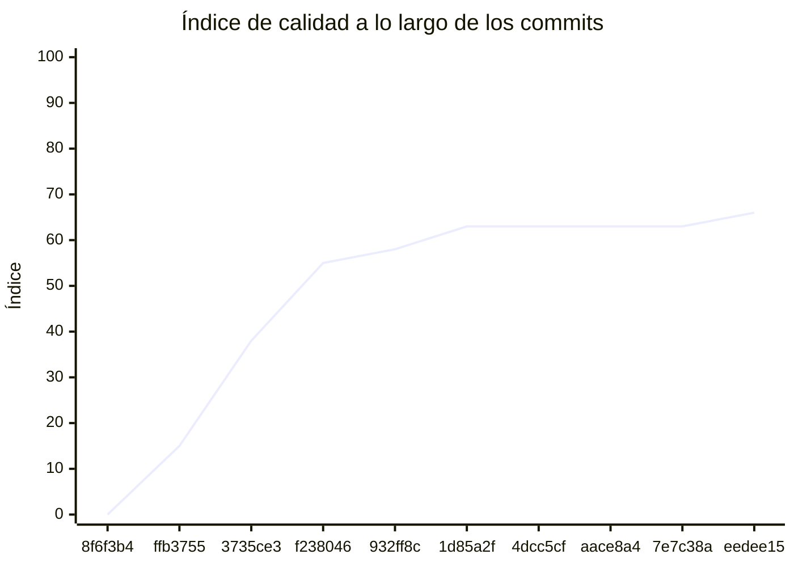

<!-- evaluacion:inicio -->
# Evaluación — TONEATTI-PROGRAMACION-TRABAJO-FINAL/Servicio-turnos

> Documento **generado automáticamente** por la cátedra de Programación II (UM): RepoSense + análisis de calidad de **7 dimensiones**. **No editar a mano**: se regenera en cada evaluación.
> Rama evaluada: `main`. Análisis **heurístico** (regex + métricas) + build: es una criba para orientar la revisión, **no una nota**. La **documentación** del repositorio no se evalúa.
> Generado: 2026-11-20.

## 1. Veredicto

| Aspecto | Resultado |
|---|---|
| Índice de calidad | **78/100** |
| Tipo de repositorio | `backend` |
| Build (`mvnw verify` / `gradlew check`) | OK |
| Código (LOC) | 11,549 |
| Archivos de código | 237 |
| Clases | 250 |
| Código dentro de clases (%POO) | 67% |
| Funciones fuera de clases | 0 |
| Duplicación (puerta) | 1.4% |
| Duplicación lógica | 1.5% |
| Duplicación de boilerplate | 9.4% |
| Cobertura | 99% |
| Tope duro aplicado a D1 | `POO_BAJO` → D1 ≤ 60 |

> Este informe **describe** lo que el análisis midió con los criterios ya establecidos de la materia. No es una nota.

## 2. Semáforo de aprobación

Criterios de la cátedra (`CRITERIOS-CALIDAD.md`): **Aprobar** se juega con el perfil `estandar`; **destacar**, con el `exigente` (meta de excelencia).

| Semáforo | Resultado |
|---|---|
| Aprobar (`estandar`) | **no cumple** — 7/11 |
| Destacar (`exigente`) | **no cumple** — 5/11 |

**Para aprobar, falta cumplir:** SOLID

**Para destacar, falta cumplir:** SOLID; POO; Duplicación

## 3. Autoría (RepoSense)

| Autor | Commits | Código (LOC) | Tests (LOC) | Docs (LOC) | Días activos | % del código |
|---|---:|---:|---:|---:|---:|---:|
| LucianoToneatti | 82 | 5,212 | 8,519 | 376 | 21 | 100% |

> _El LOC de autoría lo calcula RepoSense sobre el historial y puede diferir del LOC de código del análisis (que mira el estado de `main`)._

## 4. Dimensiones evaluadas

Cada dimensión indica **qué mide**, **por qué importa** y **tu resultado**. Cuando el puntaje queda por debajo de la referencia, se agregan preguntas para **investigar la causa** (no hay recetas).

| Dimensión | Peso | Puntaje |
|:--|--:|--:|
| **D1** Diseño OO, SOLID y patrones (20%) | 20% | 4 |
| **D2** Arquitectura hexagonal — backend (15%) | 15% | 100 |
| **D3** Frontend KMP: MVVM y buenas prácticas (10%) | 10% | N/A |
| **D4** Integración y contrato (10%) | 10% | 90 |
| **D5** Seguridad y robustez (10%) | 10% | 100 |
| **D6** Pruebas y cobertura (20%) | 20% | 100 |
| **D7** Proceso y entrega (15%) | 15% | 100 |

### D1. Diseño OO, SOLID y patrones (20%)

- **Qué mide:** Métricas orientadas a objetos (clases, métodos, campos, cohesión, acoplamiento, herencia) y proxies de SOLID, más patrones de diseño.
- **Por qué importa:** El eje de la materia es el buen uso de la POO y su arquitectura: un diseño con clases claras y poco acopladas es más fácil de entender, probar y cambiar.
- **Tu resultado:** **4/100**
- **Para investigar la causa:**
    - ¿Se pensó el modelo de clases antes de codificar o se agrupó después?
    - ¿Qué clases concentran muchas responsabilidades a la vez?
    - ¿Los colaboradores llegan como parámetros o se crean por dentro?

### D2. Arquitectura hexagonal — backend (15%)

- **Qué mide:** Separación en capas (dominio, puertos de entrada/salida, adaptadores) y dirección de las dependencias del backend.
- **Por qué importa:** Aislar el dominio de la infraestructura permite cambiar la base de datos, el framework o el transporte sin tocar las reglas de negocio.
- **Tu resultado:** **100/100**

### D4. Integración y contrato (10%)

- **Qué mide:** Cumplimiento del contrato de integración de la cátedra (formato de errores, paginación, autenticación, endpoints esperados).
- **Por qué importa:** Los servicios deben poder integrarse entre sí y con la app sin sorpresas; el contrato es lo que hacen cumplir las pruebas de integración.
- **Tu resultado:** **90/100**

### D5. Seguridad y robustez (10%)

- **Qué mide:** Credenciales embebidas, consultas SQL por concatenación, y presencia de config de entorno; aislamiento de secretos.
- **Por qué importa:** Un secreto en el repositorio o una consulta construida por concatenación son riesgos concretos, no hipotéticos.
- **Tu resultado:** **100/100**

### D6. Pruebas y cobertura (20%)

- **Qué mide:** Cantidad y resultado de pruebas y cobertura de línea (JaCoCo/Kover, Surefire/Failsafe) cuando hay build.
- **Por qué importa:** Las pruebas son la red de seguridad para refactorizar e integrar; la cobertura acota las zonas sin verificar.
- **Tu resultado:** **100/100**

### D7. Proceso y entrega (15%)

- **Qué mide:** Artefactos verificables de proceso/entrega: `compose`, `.env.example`, CI (`.github/workflows/`), `CODEOWNERS` y wrapper de build (`mvnw`/`gradlew`). **No** puntúa documentación.
- **Por qué importa:** Un proyecto que compila, se levanta y se valida solo es más fácil de revisar y de integrar en equipo.
- **Tu resultado:** **100/100**

## 5. Señales detectadas

El análisis encontró las siguientes señales, con el archivo y la línea donde se originan cuando están disponibles:

**Archivos con más señales**

| Archivo | Señales |
|---|---:|
| `src/main/java/com/toneatti/turnos/reservation/infrastructure/web/controller/ReservationController.java` | 8 |
| `src/main/java/com/toneatti/turnos/catedra/infrastructure/rest/adapter/RestCatedraRepositoryAdapter.java` | 7 |
| `src/main/java/com/toneatti/turnos/reservation/domain/model/ReservationProcess.java` | 7 |
| `src/main/java/com/toneatti/turnos/reservation/application/usecases/StartReservationUseCaseImpl.java` | 6 |
| `src/main/java/com/toneatti/turnos/reservation/application/service/ReservationService.java` | 4 |
| `src/main/java/com/toneatti/turnos/reservation/application/usecases/CancelReservationUseCaseImpl.java` | 4 |
| `src/main/java/com/toneatti/turnos/availability/application/usecases/GetAvailableSlotsUseCaseImpl.java` | 4 |
| `src/main/java/com/toneatti/turnos/config/CatedraIntegrationProperties.java` | 4 |
| `src/main/java/com/toneatti/turnos/catedra/infrastructure/rest/dto/CatedraAppointmentListResponse.java` | 3 |
| `src/main/java/com/toneatti/turnos/reservation/infrastructure/kafka/mapper/AppointmentActionMessageMapper.java` | 3 |

**DIP/concretos** (47)
- clase 'GetAvailableSlotsUseCaseImpl' muy acoplada (CBO=29) — `src/main/java/com/toneatti/turnos/availability/application/usecases/GetAvailableSlotsUseCaseImpl.java:38`
- clase 'GetAvailableSlotsUseCaseImpl' instancia 7 concretos (CBO=29) — `src/main/java/com/toneatti/turnos/availability/application/usecases/GetAvailableSlotsUseCaseImpl.java:38`
- clase 'AvailabilityController' muy acoplada (CBO=30) — `src/main/java/com/toneatti/turnos/availability/infrastructure/web/controller/AvailabilityController.java:30`
- clase 'RestCatalogoRepositoryAdapter' muy acoplada (CBO=19) — `src/main/java/com/toneatti/turnos/catalogo/infrastructure/rest/adapter/RestCatalogoRepositoryAdapter.java:29`
- clase 'ProfessionalCategoryController' muy acoplada (CBO=13) — `src/main/java/com/toneatti/turnos/catalogo/infrastructure/web/controller/ProfessionalCategoryController.java:23`
- clase 'ProfessionalController' muy acoplada (CBO=17) — `src/main/java/com/toneatti/turnos/catalogo/infrastructure/web/controller/ProfessionalController.java:26`
- clase 'CatedraRepository' muy acoplada (CBO=20) — `src/main/java/com/toneatti/turnos/catedra/domain/ports/out/CatedraRepository.java:22`
- clase 'RestCatedraRepositoryAdapter' muy acoplada (CBO=53) — `src/main/java/com/toneatti/turnos/catedra/infrastructure/rest/adapter/RestCatedraRepositoryAdapter.java:51`
- clase 'RestCatedraRepositoryAdapter' instancia 8 concretos (CBO=53) — `src/main/java/com/toneatti/turnos/catedra/infrastructure/rest/adapter/RestCatedraRepositoryAdapter.java:51`
- clase 'CatedraRestMapper' muy acoplada (CBO=12) — `src/main/java/com/toneatti/turnos/catedra/infrastructure/rest/mapper/CatedraRestMapper.java:18`
- clase 'CatedraRestMapper' instancia 6 concretos (CBO=12) — `src/main/java/com/toneatti/turnos/catedra/infrastructure/rest/mapper/CatedraRestMapper.java:18`
- clase 'CatedraIntegrationProperties' muy acoplada (CBO=9) — `src/main/java/com/toneatti/turnos/config/CatedraIntegrationProperties.java:23`
- clase 'SecurityConfig' muy acoplada (CBO=38) — `src/main/java/com/toneatti/turnos/config/SecurityConfig.java:31`
- clase 'UserJwtProperties' muy acoplada (CBO=8) — `src/main/java/com/toneatti/turnos/config/UserJwtProperties.java:19`
- clase 'ReservationService' muy acoplada (CBO=16) — `src/main/java/com/toneatti/turnos/reservation/application/service/ReservationService.java:24`
- clase 'ReservationService' instancia 3 concretos (CBO=16) — `src/main/java/com/toneatti/turnos/reservation/application/service/ReservationService.java:24`
- clase 'ApplyAppointmentActionUseCaseImpl' muy acoplada (CBO=17) — `src/main/java/com/toneatti/turnos/reservation/application/usecases/ApplyAppointmentActionUseCaseImpl.java:28`
- clase 'CancelReservationUseCaseImpl' muy acoplada (CBO=30) — `src/main/java/com/toneatti/turnos/reservation/application/usecases/CancelReservationUseCaseImpl.java:40`
- clase 'CancelReservationUseCaseImpl' instancia 8 concretos (CBO=30) — `src/main/java/com/toneatti/turnos/reservation/application/usecases/CancelReservationUseCaseImpl.java:40`
- clase 'GetReservationByIdUseCaseImpl' muy acoplada (CBO=11) — `src/main/java/com/toneatti/turnos/reservation/application/usecases/GetReservationByIdUseCaseImpl.java:20`
- clase 'ListReservationsUseCaseImpl' muy acoplada (CBO=15) — `src/main/java/com/toneatti/turnos/reservation/application/usecases/ListReservationsUseCaseImpl.java:23`
- clase 'ListReservationsUseCaseImpl' instancia 4 concretos (CBO=15) — `src/main/java/com/toneatti/turnos/reservation/application/usecases/ListReservationsUseCaseImpl.java:23`
- clase 'StartReservationUseCaseImpl' muy acoplada (CBO=61) — `src/main/java/com/toneatti/turnos/reservation/application/usecases/StartReservationUseCaseImpl.java:64`
- clase 'StartReservationUseCaseImpl' instancia 15 concretos (CBO=61) — `src/main/java/com/toneatti/turnos/reservation/application/usecases/StartReservationUseCaseImpl.java:64`
- clase 'SubmitPhoneUseCaseImpl' muy acoplada (CBO=15) — `src/main/java/com/toneatti/turnos/reservation/application/usecases/SubmitPhoneUseCaseImpl.java:33`
- clase 'SubmitPhoneUseCaseImpl' instancia 4 concretos (CBO=15) — `src/main/java/com/toneatti/turnos/reservation/application/usecases/SubmitPhoneUseCaseImpl.java:33`
- clase 'ReservationProcess' muy acoplada (CBO=24) — `src/main/java/com/toneatti/turnos/reservation/domain/model/ReservationProcess.java:24`
- clase 'ReservationProcess' instancia 3 concretos (CBO=24) — `src/main/java/com/toneatti/turnos/reservation/domain/model/ReservationProcess.java:24`
- clase 'ReservationStatus' muy acoplada (CBO=9) — `src/main/java/com/toneatti/turnos/reservation/domain/model/ReservationStatus.java:18`
- clase 'KafkaPhoneSubmissionPublisherAdapter' muy acoplada (CBO=14) — `src/main/java/com/toneatti/turnos/reservation/infrastructure/kafka/adapter/KafkaPhoneSubmissionPublisherAdapter.java:28`
- clase 'AppointmentActionsKafkaConfig' muy acoplada (CBO=23) — `src/main/java/com/toneatti/turnos/reservation/infrastructure/kafka/config/AppointmentActionsKafkaConfig.java:28`
- clase 'PhoneSubmissionKafkaConfig' muy acoplada (CBO=18) — `src/main/java/com/toneatti/turnos/reservation/infrastructure/kafka/config/PhoneSubmissionKafkaConfig.java:25`
- clase 'AppointmentActionListener' muy acoplada (CBO=11) — `src/main/java/com/toneatti/turnos/reservation/infrastructure/kafka/listener/AppointmentActionListener.java:24`
- clase 'AppointmentActionMessageMapper' muy acoplada (CBO=12) — `src/main/java/com/toneatti/turnos/reservation/infrastructure/kafka/mapper/AppointmentActionMessageMapper.java:19`
- clase 'AppointmentActionMessageMapper' instancia 9 concretos (CBO=12) — `src/main/java/com/toneatti/turnos/reservation/infrastructure/kafka/mapper/AppointmentActionMessageMapper.java:19`
- clase 'JpaReservationProcessRepositoryAdapter' muy acoplada (CBO=16) — `src/main/java/com/toneatti/turnos/reservation/infrastructure/persistence/adapter/JpaReservationProcessRepositoryAdapter.java:22`
- clase 'ReservationProcessEntity' muy acoplada (CBO=16) — `src/main/java/com/toneatti/turnos/reservation/infrastructure/persistence/entity/ReservationProcessEntity.java:30`
- clase 'ReservationController' muy acoplada (CBO=83) — `src/main/java/com/toneatti/turnos/reservation/infrastructure/web/controller/ReservationController.java:60`
- clase 'ReservationDtoMapper' muy acoplada (CBO=13) — `src/main/java/com/toneatti/turnos/reservation/infrastructure/web/mapper/ReservationDtoMapper.java:17`
- clase 'UserService' muy acoplada (CBO=8) — `src/main/java/com/toneatti/turnos/user/application/service/UserService.java:14`
- clase 'LoginUserUseCaseImpl' muy acoplada (CBO=8) — `src/main/java/com/toneatti/turnos/user/application/usecases/LoginUserUseCaseImpl.java:14`
- clase 'RegisterUserUseCaseImpl' muy acoplada (CBO=8) — `src/main/java/com/toneatti/turnos/user/application/usecases/RegisterUserUseCaseImpl.java:16`
- clase 'JpaUserRepositoryAdapter' muy acoplada (CBO=8) — `src/main/java/com/toneatti/turnos/user/infrastructure/persistence/adapter/JpaUserRepositoryAdapter.java:17`
- clase 'JwtAccessTokenIssuerAdapter' muy acoplada (CBO=14) — `src/main/java/com/toneatti/turnos/user/infrastructure/security/JwtAccessTokenIssuerAdapter.java:24`
- clase 'UserController' muy acoplada (CBO=25) — `src/main/java/com/toneatti/turnos/user/infrastructure/web/controller/UserController.java:28`
- clase 'UserController' instancia 3 concretos (CBO=25) — `src/main/java/com/toneatti/turnos/user/infrastructure/web/controller/UserController.java:28`
- clase 'UserDtoMapper' muy acoplada (CBO=8) — `src/main/java/com/toneatti/turnos/user/infrastructure/web/mapper/UserDtoMapper.java:13`

**SRP/responsabilidad** (49)
- clase 'GetAvailableSlotsUseCaseImpl' con baja cohesión (0%) — `src/main/java/com/toneatti/turnos/availability/application/usecases/GetAvailableSlotsUseCaseImpl.java:38`
- método 'GetAvailableSlotsUseCaseImpl.generateSlots' con complejidad 6 — `src/main/java/com/toneatti/turnos/availability/application/usecases/GetAvailableSlotsUseCaseImpl.java:78`
- método 'AvailabilityController.getAvailableSlots' con complejidad 6 — `src/main/java/com/toneatti/turnos/availability/infrastructure/web/controller/AvailabilityController.java:38`
- método 'Professional.Professional' con 5 parámetros — `src/main/java/com/toneatti/turnos/catalogo/domain/model/Professional.java:3`
- método 'WeeklySchedule.WeeklySchedule' con 6 parámetros — `src/main/java/com/toneatti/turnos/catalogo/domain/model/WeeklySchedule.java:6`
- método 'CatalogoProfessionalResponse.CatalogoProfessionalResponse' con 5 parámetros — `src/main/java/com/toneatti/turnos/catalogo/infrastructure/rest/dto/CatalogoProfessionalResponse.java:3`
- método 'CatalogoWeeklyScheduleResponse.CatalogoWeeklyScheduleResponse' con 6 parámetros — `src/main/java/com/toneatti/turnos/catalogo/infrastructure/rest/dto/CatalogoWeeklyScheduleResponse.java:6`
- clase 'CatedraRequestRejectedException' grande (LOC=28, métodos=3, campos=15) — `src/main/java/com/toneatti/turnos/catedra/domain/exception/CatedraRequestRejectedException.java:7`
- método 'Appointment.Appointment' con 7 parámetros — `src/main/java/com/toneatti/turnos/catedra/domain/model/Appointment.java:10`
- método 'AppointmentSummary.AppointmentSummary' con 17 parámetros — `src/main/java/com/toneatti/turnos/catedra/domain/model/AppointmentSummary.java:12`
- clase 'RestCatedraRepositoryAdapter' grande (LOC=169, métodos=13, campos=9) — `src/main/java/com/toneatti/turnos/catedra/infrastructure/rest/adapter/RestCatedraRepositoryAdapter.java:51`
- clase 'RestCatedraRepositoryAdapter' con baja cohesión (35%) — `src/main/java/com/toneatti/turnos/catedra/infrastructure/rest/adapter/RestCatedraRepositoryAdapter.java:51`
- método 'RestCatedraRepositoryAdapter.findAppointmentsPage' con 6 parámetros — `src/main/java/com/toneatti/turnos/catedra/infrastructure/rest/adapter/RestCatedraRepositoryAdapter.java:140`
- método 'RestCatedraRepositoryAdapter.appointmentsPageUri' con 7 parámetros — `src/main/java/com/toneatti/turnos/catedra/infrastructure/rest/adapter/RestCatedraRepositoryAdapter.java:154`
- método 'RestCatedraRepositoryAdapter.post' con 5 parámetros — `src/main/java/com/toneatti/turnos/catedra/infrastructure/rest/adapter/RestCatedraRepositoryAdapter.java:186`
- método 'CatedraAppointmentListResponse.CatedraAppointmentListResponse' con 17 parámetros — `src/main/java/com/toneatti/turnos/catedra/infrastructure/rest/dto/CatedraAppointmentListResponse.java:12`
- método 'CatedraAppointmentResponse.CatedraAppointmentResponse' con 7 parámetros — `src/main/java/com/toneatti/turnos/catedra/infrastructure/rest/dto/CatedraAppointmentResponse.java:11`
- método 'CatedraIntegrationProperties.CatedraIntegrationProperties' de 32 líneas — `src/main/java/com/toneatti/turnos/config/CatedraIntegrationProperties.java:23`
- método 'CatedraIntegrationProperties.Kafka' con 5 parámetros — `src/main/java/com/toneatti/turnos/config/CatedraIntegrationProperties.java:45`
- método 'Kafka.Kafka' con 5 parámetros — `src/main/java/com/toneatti/turnos/config/CatedraIntegrationProperties.java:45`
- clase 'SecurityConfig' con baja cohesión (0%) — `src/main/java/com/toneatti/turnos/config/SecurityConfig.java:31`
- clase 'ReservationService' con baja cohesión (0%) — `src/main/java/com/toneatti/turnos/reservation/application/service/ReservationService.java:24`
- método 'ReservationService.listReservations' con 6 parámetros — `src/main/java/com/toneatti/turnos/reservation/application/service/ReservationService.java:53`
- clase 'ApplyAppointmentActionUseCaseImpl' con baja cohesión (17%) — `src/main/java/com/toneatti/turnos/reservation/application/usecases/ApplyAppointmentActionUseCaseImpl.java:28`
- clase 'CancelReservationUseCaseImpl' con baja cohesión (13%) — `src/main/java/com/toneatti/turnos/reservation/application/usecases/CancelReservationUseCaseImpl.java:40`
- método 'CancelReservationUseCaseImpl.cancel' con complejidad 7 — `src/main/java/com/toneatti/turnos/reservation/application/usecases/CancelReservationUseCaseImpl.java:57`
- método 'ListReservationsUseCaseImpl.listReservations' con 6 parámetros — `src/main/java/com/toneatti/turnos/reservation/application/usecases/ListReservationsUseCaseImpl.java:28`
- clase 'StartReservationUseCaseImpl' grande (LOC=197, métodos=11, campos=7) — `src/main/java/com/toneatti/turnos/reservation/application/usecases/StartReservationUseCaseImpl.java:64`
- método 'StartReservationUseCaseImpl.resume' con complejidad 6 — `src/main/java/com/toneatti/turnos/reservation/application/usecases/StartReservationUseCaseImpl.java:104`
- método 'StartReservationUseCaseImpl.confirm' de 36 líneas — `src/main/java/com/toneatti/turnos/reservation/application/usecases/StartReservationUseCaseImpl.java:169`
- método 'StartReservationUseCaseImpl.confirm' con complejidad 9 — `src/main/java/com/toneatti/turnos/reservation/application/usecases/StartReservationUseCaseImpl.java:169`
- método 'PhoneSubmission.PhoneSubmission' con 6 parámetros — `src/main/java/com/toneatti/turnos/reservation/domain/model/PhoneSubmission.java:10`
- método 'ProcessedAppointmentAction.ProcessedAppointmentAction' con 6 parámetros — `src/main/java/com/toneatti/turnos/reservation/domain/model/ProcessedAppointmentAction.java:8`
- clase 'ReservationProcess' grande (LOC=219, métodos=36, campos=17) — `src/main/java/com/toneatti/turnos/reservation/domain/model/ReservationProcess.java:24`
- clase 'ReservationProcess' con baja cohesión (16%) — `src/main/java/com/toneatti/turnos/reservation/domain/model/ReservationProcess.java:24`
- método 'ReservationProcess.ReservationProcess' con 17 parámetros — `src/main/java/com/toneatti/turnos/reservation/domain/model/ReservationProcess.java:44`
- método 'ReservationProcess.start' con 5 parámetros — `src/main/java/com/toneatti/turnos/reservation/domain/model/ReservationProcess.java:68`
- método 'ReservationProcess.apply' con complejidad 7 — `src/main/java/com/toneatti/turnos/reservation/domain/model/ReservationProcess.java:105`
- método 'ReservationStatus.nextStatuses' con complejidad 7 — `src/main/java/com/toneatti/turnos/reservation/domain/model/ReservationStatus.java:41`
- método 'AdditionalInformationSubmittedMessage.AdditionalInformationSubmittedMessage' con 9 parámetros — `src/main/java/com/toneatti/turnos/reservation/infrastructure/kafka/dto/AdditionalInformationSubmittedMessage.java:9`
- método 'AppointmentActionMessage.AppointmentActionMessage' con 7 parámetros — `src/main/java/com/toneatti/turnos/reservation/infrastructure/kafka/dto/AppointmentActionMessage.java:13`
- método 'AppointmentActionMessageMapper.toDomain' con complejidad 9 — `src/main/java/com/toneatti/turnos/reservation/infrastructure/kafka/mapper/AppointmentActionMessageMapper.java:23`
- clase 'ReservationController' grande (LOC=176, métodos=11, campos=4) — `src/main/java/com/toneatti/turnos/reservation/infrastructure/web/controller/ReservationController.java:60`
- clase 'ReservationController' con baja cohesión (20%) — `src/main/java/com/toneatti/turnos/reservation/infrastructure/web/controller/ReservationController.java:60`
- método 'ReservationController.startReservation' de 33 líneas — `src/main/java/com/toneatti/turnos/reservation/infrastructure/web/controller/ReservationController.java:71`
- método 'ReservationController.startReservation' con complejidad 10 — `src/main/java/com/toneatti/turnos/reservation/infrastructure/web/controller/ReservationController.java:71`
- método 'ReservationController.submitPhone' con complejidad 8 — `src/main/java/com/toneatti/turnos/reservation/infrastructure/web/controller/ReservationController.java:150`
- método 'ReservationController.cancelReservation' con complejidad 8 — `src/main/java/com/toneatti/turnos/reservation/infrastructure/web/controller/ReservationController.java:181`
- método 'User.User' con 7 parámetros — `src/main/java/com/toneatti/turnos/user/domain/model/User.java:6`

**POO** (1)
- clase 'CatedraRequestRejectedException' con 13 campos públicos (encapsulación) — `src/main/java/com/toneatti/turnos/catedra/domain/exception/CatedraRequestRejectedException.java:7`

**OCP/type-switch** (1)
- clase 'ReservationController' con 1 type-checks — `src/main/java/com/toneatti/turnos/reservation/infrastructure/web/controller/ReservationController.java:60`

**ISP/interfaces** (1)
- interfaz 'AppointmentAction' con 6 métodos — `src/main/java/com/toneatti/turnos/reservation/domain/model/AppointmentAction.java:10`

**duplicación** (6)
- duplicación lógica: 1.4% · boilerplate: 9.4%
- bloque de 8 líneas repetido 2 veces en src/main/java/com/toneatti/turnos/catalogo/infrastructure/rest/dto/CatalogoWeeklyScheduleResponse.java:7, src/main/java/com/toneatti/turnos/catalogo/domain/model/WeeklySchedule.java:7 — `src/main/java/com/toneatti/turnos/catalogo/infrastructure/rest/dto/CatalogoWeeklyScheduleResponse.java:7`
- bloque de 8 líneas repetido 2 veces en src/main/java/com/toneatti/turnos/catedra/infrastructure/rest/dto/CatedraAppointmentListResponse.java:20, src/main/java/com/toneatti/turnos/catedra/domain/model/AppointmentSummary.java:20 — `src/main/java/com/toneatti/turnos/catedra/infrastructure/rest/dto/CatedraAppointmentListResponse.java:20`
- bloque de 8 líneas repetido 2 veces en src/main/java/com/toneatti/turnos/catedra/infrastructure/rest/dto/CatedraAppointmentListResponse.java:21, src/main/java/com/toneatti/turnos/catedra/domain/model/AppointmentSummary.java:21 — `src/main/java/com/toneatti/turnos/catedra/infrastructure/rest/dto/CatedraAppointmentListResponse.java:21`
- bloque de 8 líneas repetido 7 veces en src/test/java/com/toneatti/turnos/catedra/infrastructure/rest/adapter/RestCatedraRepositoryAdapterTest.java:332, src/test/java/com/toneatti/turnos/catedra/infrastructure/rest/adapter/RestCatedraRepositoryAdapterTest.java:333, src/test/java/com/toneatti/turnos/reservation/infrastructure/web/controller/ReservationIntegrationTest.java:194 — `src/test/java/com/toneatti/turnos/catedra/infrastructure/rest/adapter/RestCatedraRepositoryAdapterTest.java:332`
- bloque de 8 líneas repetido 3 veces en src/test/java/com/toneatti/turnos/catedra/infrastructure/rest/adapter/RestCatedraRepositoryAdapterTest.java:334, src/test/java/com/toneatti/turnos/reservation/infrastructure/web/controller/ReservationIntegrationTest.java:195, src/test/java/com/toneatti/turnos/reservation/domain/model/ReservationStatusTest.java:20 — `src/test/java/com/toneatti/turnos/catedra/infrastructure/rest/adapter/RestCatedraRepositoryAdapterTest.java:334`

## 6. Evolución por commit

Métricas calculadas sobre el estado de `main` en **cada commit** (10 commits con trabajo), del primero al último. La calidad usa el perfil `exigente`; el aporte de código lo mide RepoSense. El índice puede **bajar** al crecer el proyecto: se acumulan señales.

| # | Fecha | Commit | Autor | LOC | Índice | %POO | Duplic. | Sueltas |
|---|---|---|---|---:|---:|---:|---:|---:|
| 1 | 2026-09-10 | `8f6f3b4` | LucianoToneatti | 0 | 0 | 0% | 0.0% | 0 |
| 2 | 2026-09-15 | `ffb3755` | Ing. Daniel Quinteros | 0 | 15 | 0% | 0.0% | 0 |
| 3 | 2026-10-13 | `3735ce3` | LucianoToneatti | 18 | 38 | 56% | 0.0% | 0 |
| 4 | 2026-10-19 | `f238046` | LucianoToneatti | 911 | 55 | 62% | 7.6% | 0 |
| 5 | 2026-10-21 | `932ff8c` | LucianoToneatti | 1,815 | 58 | 61% | 5.1% | 0 |
| 6 | 2026-10-26 | `1d85a2f` | LucianoToneatti | 3,687 | 63 | 63% | 1.4% | 0 |
| 7 | 2026-10-29 | `4dcc5cf` | LucianoToneatti | 6,525 | 63 | 67% | 1.8% | 0 |
| 8 | 2026-10-31 | `aace8a4` | LucianoToneatti | 9,308 | 63 | 68% | 1.4% | 0 |
| 9 | 2026-11-01 | `7e7c38a` | LucianoToneatti | 11,469 | 63 | 67% | 1.4% | 0 |
| 10 | 2026-11-14 | `eedee15` | LucianoToneatti | 11,549 | 66 | 67% | 1.4% | 0 |

---
_Informe generado por la cátedra. Las dimensiones y umbrales corresponden a `calidad.py` (perfil `exigente`); el semáforo, a `CRITERIOS-CALIDAD.md`. La documentación del repositorio no se evalúa. Ante dudas, revisá el archivo señalado._
<!-- evaluacion:fin -->
